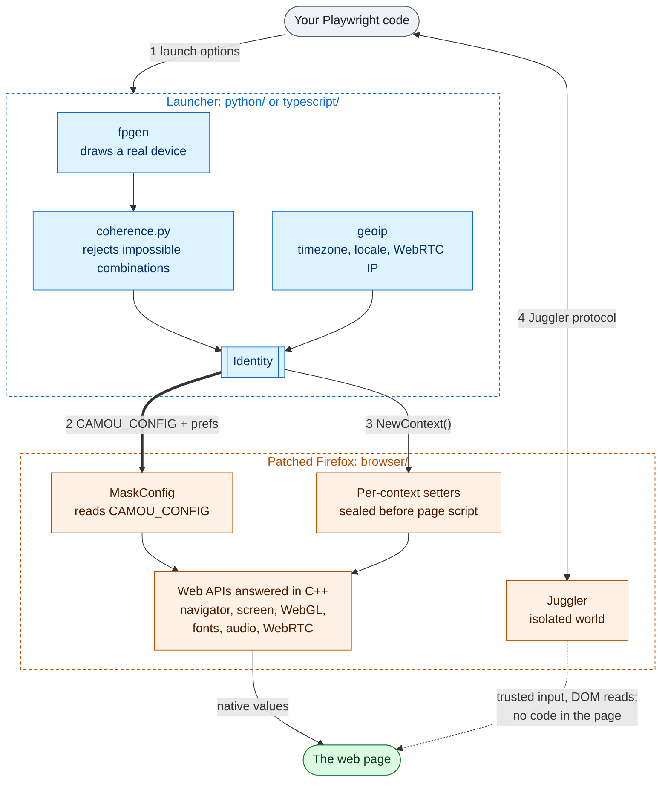
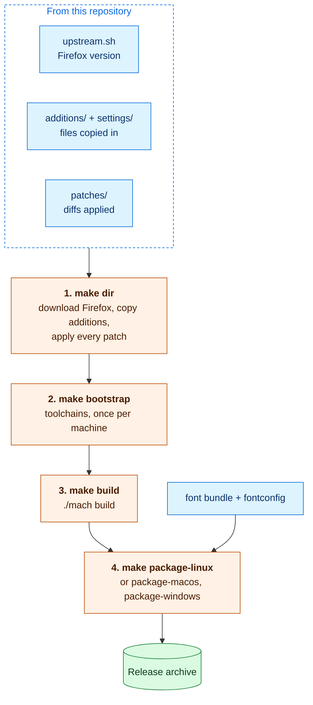
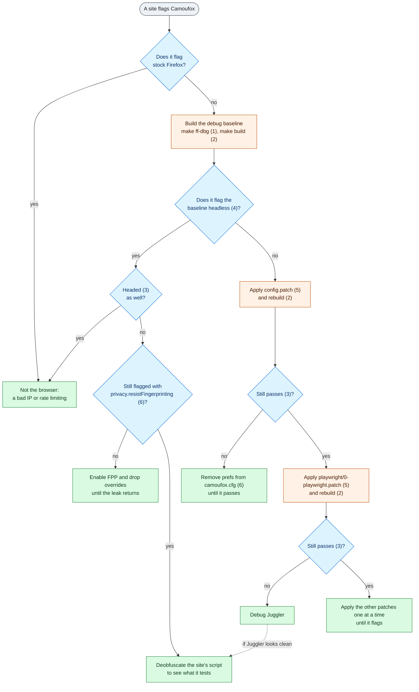

# camoufox-beta

A fork of [Camoufox](https://github.com/daijro/camoufox), the Firefox build for
web scraping and browser automation that spoofs device fingerprints in C++
rather than with injected JavaScript. Each launch gets an identity drawn from
the real-world distribution of devices
([fpgen](https://github.com/scrapfly/fingerprint-generator)), checked for
internal consistency, and driven through a patched Playwright protocol that
pages cannot see.

This fork follows upstream `main` (merged 2026-10-17, 18604fa, Firefox
156.0.1) and releases its own builds as `v156.0.1-beta.32-cg.N`. The
differences are listed below. Fixes made here are offered upstream.

> [!NOTE]
> Under development. Test a release against your own targets before relying on it.

---

## How this fork differs from [daijro/camoufox](https://github.com/daijro/camoufox) `main`

**Build and releases**
- Linux x86_64 only, built by this repository's CI ([`build.yml`](.github/workflows/build.yml)) and published as GitHub releases with sha256 digests. No PyPI or npm packages are published from here, and upstream's release train does not run.
- Cross-language LTO and profile-guided optimization with a pinned profile, and Rust SIMD, as stock Firefox builds ([`ci/pgo.py`](ci/pgo.py)). A release is refused until a profile is pinned for its Firefox. The font bundle is hosted in this repository's releases.

**Browser**
- **Config and getter cost.** Config lookups go through a precomputed index, and per-context getters are memoized without a synchronous round trip to the parent on first read. Spoofed getters do the same work stock ones do before returning, so their timing matches stock Firefox.
- **Fonts.** Per-script fallback fonts follow the claimed OS on Linux builds, and each identity gets its OS's stock font prefs.
- **Windows identity on a Linux host.** Media `decodingInfo` and hardware codecs, WebGPU with Windows limits, DirectWrite line metrics, the keyboard, and `Math.sin`/`cos`/`tan`/`pow` answer as Windows does.
- **Input.**
  - Juggler's input waits are bounded, and the first cursor move of a page enters from the top edge instead of (0, 0).
  - Wheel deltas stay correct at display scales other than 1.
  - Humanized moves are paced on their own schedule, so acks do not stretch them.
  - `humanize_engine="mousecrack"` adds a second cursor generator (see [Human cursor](#human-cursor)).
- **uBlock Origin** does not hold page loads while it compiles its lists; requests in the first seconds of a launch are not filtered.

**Python launcher**
- Scrollbars are drawn as the claimed OS draws them, even on a host running a different OS.
- The identity's devicePixelRatio is rendered (`layout.css.devPixelsPerPx`), not just reported.
- Web Audio can render stock Firefox's value in every context instead of a per-identity noised one.
- `block_webrtc`, `block_images` and `disable_coop` write their prefs on every launch, on or off, so a persistent profile does not keep a setting after the flag is removed.
- The TypeScript launcher is in the tree as upstream has it, but its CI jobs do not gate this fork's builds, and not every launcher change here is ported to it.

---

## Installing

Each release carries a Linux x86_64 browser zip and its sha256 in
[Releases](https://github.com/coffeegrind123/camoufox-beta/releases). Install
the launcher from the commit the release tag points at, so the two agree about
the config properties:

```bash
pip install "camoufox[geoip] @ git+https://github.com/coffeegrind123/camoufox-beta.git@<release commit>#subdirectory=python"
```

Every commit reports the same package version, so pass `--force-reinstall`
when moving between commits. Then unpack the browser zip, check its sha256
against the release's `digest`, and point the launcher at it:

```python
from camoufox.sync_api import Camoufox

with Camoufox(executable_path="/opt/camoufox/camoufox-bin") as browser:
    page = browser.new_page()
    page.goto("https://example.com")
```

```python
import asyncio
from camoufox.async_api import AsyncCamoufox

async def main():
    async with AsyncCamoufox(executable_path="/opt/camoufox/camoufox-bin") as browser:
        page = await browser.new_page()
        await page.goto("https://example.com")

asyncio.run(main())
```

What you get back is a normal Playwright `Browser`. Behind a proxy, add
`proxy=...` and `geoip=True` so timezone, locale, geolocation and the WebRTC IP
match the exit IP. For many identities in one browser, use `NewContext()`. The
launcher's options are in [`python/README.md`](python/README.md).

The launcher installs fpgen's model itself, pinned by URL and sha256 and
verified. To install it ahead of time, for example while building an image as
the owner of fpgen's package directory:

```bash
python -c "from camoufox.fpgen_model import ensure_fpgen_model; ensure_fpgen_model()"
```

`camoufox fetch` downloads browsers from the repositories in
[`python/src/camoufox/repos.yml`](python/src/camoufox/repos.yml) (upstream's),
not from this fork's releases.

## How it fits together



1. The launcher draws a device from [fpgen](https://github.com/scrapfly/fingerprint-generator)
   (a model of real traffic), then adds fonts, voices, a GPU and media devices
   seeded by that identity. `coherence.py` rejects combinations no real machine
   produces.
2. The identity goes to the browser as the `CAMOU_CONFIG` environment variable
   (keys declared in [`browser/settings/properties.json`](browser/settings/properties.json)).
   The patches read it through `MaskConfig` and answer from C++.
3. `NewContext()` gives one context its own identity through setters that the
   per-context patches add to `window`. They are sealed before page script runs.
4. Playwright talks to Juggler. Camoufox's Juggler runs its page agent in an
   isolated world, so the page never sees automation code.

# Features

Each row says where it is implemented. A **patch** is a file in
[`browser/patches/`](browser/patches); **Juggler** is
[`browser/additions/juggler/`](browser/additions/juggler); the **launcher** is
the Python and TypeScript packages.

### Fingerprint spoofing

The goal is a browser that behaves exactly like stock Firefox, except that it
reports a different machine. A value is spoofed when it identifies the host
machine or the network. Anything else stays as Firefox has it, because
something stock Firefox never does, such as noise, is a fingerprint in its own
right.

| Trait | What a page sees | Why it is spoofed | Where |
|---|---|---|---|
| Navigator: User-Agent, platform, oscpu, hardware concurrency, language, appVersion | The drawn device's values, per launch or per context, in workers too | They name the OS and hardware directly, and every other value is checked against them | `navigator-spoofing`, `fingerprint-injection` patches |
| HTTP headers: User-Agent, Accept-Language | The navigator values | Servers compare the headers with what script reports | `network-patches` patch |
| Screen and window sizes, color depth, CSS media features | The drawn device's display, the same in JS and CSS | Screen size is among the most identifying values, and CSS media queries read it without script | `screen-spoofing`, `fingerprint-injection` patches |
| WebGL and WebGL2: vendor, renderer, parameters, extensions, shader precision, context attributes | One GPU fpgen recorded for Firefox on that OS. Values Firefox decides rather than the GPU follow the shipped Firefox ([`webgl-browser-owned-values-follow-firefox`](ci/tribal-rules.yml)) | The renderer string names the host's GPU, and its limits must agree with it | `webgl-spoofing` patch, `webgl.py` |
| WebGPU: `navigator.gpu` and its adapter | `navigator.gpu` only where Firefox on the claimed device has it: Windows and Apple Silicon Macs. The adapter is the host's only when the identity claims the host's GPU; otherwise `requestAdapter()` returns `null`, as for a blocked or software GPU | The adapter's limits and features come from the real GPU | launcher, `host_rendering.py` |
| Audio: sample rate, output latency, max channels, and the audio fingerprint | The identity's values, seeded per identity | Audio output varies with hardware and drivers, so identities sharing one could be linked | `audio-context-spoofing`, `audio-fingerprint-manager` patches |
| Fonts: installed list, `system-ui`, CSS2 system fonts | The claimed OS's fonts, from a bundled set; see [docs/FONTS.md](docs/FONTS.md) | Installed fonts reveal the OS and the software on it | `font-list-spoofing`, `font-hijacker`, `system-ui-font-spoofing` patches |
| Speech voices | The claimed OS's voices, which actually speak | The voice list is specific to each OS, and a voice that cannot speak is a tell | `voice-spoofing`, `speech-voices-spoofing` patches |
| Microphones, cameras, speakers | OS-style labels and groups; see [docs/MEDIA-DEVICES.md](docs/MEDIA-DEVICES.md) | Device count and labels differ per machine and per OS | `media-device-spoofing` patch |
| Media codecs (`canPlayType`, `isTypeSupported`) | Not the host's codec libraries | On Linux the answer depends on the host's installed codec libraries | `media-codec-spoofing` patch |
| Timezone, locale and `Intl` | The identity's, per realm, workers included | They must agree with the IP's country | `timezone-spoofing`, `locale-spoofing` patches |
| Geolocation | Coordinates from GeoIP, permission granted | They must agree with the IP | `geolocation-spoofing` patch, launcher |
| WebRTC IP | ICE candidates, SDP and `getStats()` rewritten to the proxy IP | WebRTC otherwise reveals the real IP behind a proxy | `webrtc-ip-spoofing` patch |
| Touchscreen | A touchscreen laptop, not a phone | Touch points and pointer media must agree with the claimed device | `touchscreen-fingerprint-spoofing`, `force-default-pointer` patches |

Left as stock Firefox has it, on purpose:

| Trait | What a page sees | Why it is not spoofed |
|---|---|---|
| Canvas pixels | What the GPU and fonts produce. As in stock Firefox, each context's PNG exports (`toDataURL`, `toBlob`) carry a per-session `deBG` chunk; the pixels themselves are untouched. On the host's OS the identity claims the host's GPU, so the pixels agree with it; on another OS readback returns random data, as `privacy.resistFingerprinting` does in LibreWolf ([the canvas on another OS](python/README.md#the-canvas-on-another-os)) | Stock Firefox does not perturb pixels in its default configuration, so noise would only mark the browser as a spoofer ([`canvas-is-not-noised`](ci/tribal-rules.yml)) |
| Text widths | What the font really measures | The same font on the same OS measures the same everywhere; widths no real machine produces are a fingerprint ([`no-glyph-spacing-noise`](ci/tribal-rules.yml)) |

Each context of one browser can carry its own identity:
[docs/per-context-patches.md](docs/per-context-patches.md).

### Canvas

Canvas and WebGL pixels come from the real OS, driver and GPU, whatever the
identity claims. The launcher chooses the canvas behaviour from two facts: does
the identity claim the host's OS, and does the host render on a GPU?

| | Identity on the host's OS | Identity on another OS |
|---|---|---|
| **GPU rendering** | 🟢 <ins><b>Most stealthy</b></ins><br/>&nbsp;&nbsp;&nbsp;&nbsp;✅ No canvas noise: looks like stock Firefox<br/>&nbsp;&nbsp;&nbsp;&nbsp;✅ The claimed GPU is the host's, so the pixels agree with it<br/>&nbsp;&nbsp;&nbsp;&nbsp;⛔ Every identity on this machine claims the same GPU, so there is less fingerprint diversity | 🟡 <ins><b>Less stealthy</b></ins><br/>&nbsp;&nbsp;&nbsp;&nbsp;✅ Readback is random, so the real OS does not show<br/>&nbsp;&nbsp;&nbsp;&nbsp;✅ A GPU is drawn per identity, so identities differ<br/>&nbsp;&nbsp;&nbsp;&nbsp;⛔ Canvas noise: looks like LibreWolf, Tor Browser or Mullvad Browser, which are rarer than stock Firefox |
| **Software rendering**<br/>(no GPU driver, as on most servers) | 🟢 <ins><b>Stealthy</b></ins><br/>&nbsp;&nbsp;&nbsp;&nbsp;✅ No canvas noise: looks like stock Firefox<br/>&nbsp;&nbsp;&nbsp;&nbsp;✅ A GPU is drawn per identity, so identities differ<br/>&nbsp;&nbsp;&nbsp;&nbsp;⛔ Looks like a GPU falling back to software rendering, which is rarer than a working GPU | 🟡 <ins><b>Less stealthy</b></ins><br/>&nbsp;&nbsp;&nbsp;&nbsp;✅ Readback is random, so the real OS does not show<br/>&nbsp;&nbsp;&nbsp;&nbsp;✅ A GPU is drawn per identity, so identities differ<br/>&nbsp;&nbsp;&nbsp;&nbsp;⛔ Canvas noise: looks like LibreWolf, Tor Browser or Mullvad Browser, which are rarer than stock Firefox |

That is the default. These options override it:

| Override | Result |
|---|---|
| `canvas_noise=False` on another OS | 🔴 Stock Firefox, but the pixels show the real OS |
| `canvas_noise=True` on the host's OS | 🟡 Looks like LibreWolf with no need to |
| `webgl_config` naming a GPU other than the host's | 🟡 Canvas noise is turned on, as on another OS; with `canvas_noise=False`, 🔴 WebGL reports one GPU while the pixels come from another |

Noise is set per browser, not per context. Without it, every `NewContext()`
claims the host's OS. Details are in
[the canvas on another OS](python/README.md#the-canvas-on-another-os).

### Hiding automation

| What | Where |
|---|---|
| Playwright's `evaluate`, selectors and init scripts run in an isolated world the page cannot see | Juggler |
| `navigator.webdriver` is `false` | `playwright/1-leak-fixes` patch |
| `select_option`, `fill` on date and colour inputs, and `set_input_files` fire trusted events | `trusted-automation-events` patch |
| Headless reports a fine pointer, like a desktop | `force-default-pointer` patch |
| Wheel events carry native ticks, like a physical wheel | `wheel-native-ticks` patch |
| Juggler's debugger leaves no side effects content can observe | `debugger-invisible-to-content` patch |
| Per-context fingerprint setters are gone before page script runs | `window-setter-seal` patch |
| Popup blocker on, as in stock Firefox | `popup-blocker-parity` patch |
| Content-accessible chrome files match stock Firefox | `contentaccessible-parity` patch |
| Viewports never enter Responsive Design Mode; containers show no automation label | Juggler |

### Automation

| Feature | How to use it | Where |
|---|---|---|
| Human cursor movement, replayed from 2356 recordings of real people ([Cursory](https://github.com/Vinyzu/cursory)) | `humanize=True`, or a number of seconds to cap each move | Juggler `input/` |
| Human cursor movement synthesized by a trained network ([mousecrack](https://github.com/puffinsoft/mousecrack)) | `humanize=True, humanize_engine="mousecrack"` | Juggler `input/mousecrack/` |
| Run code in the page's own world | `main_world_eval=True`, then `page.evaluate("mw:...")` | Juggler |
| Finish animations at once so Playwright never waits | `config={"instantAnimations": True}` (detectable; warns) | `no-css-animations` patch |
| Read closed shadow roots | `config={"forceScopeAccess": True}` | `shadow-root-bypass` patch |
| Many identities in one browser | `NewContext(browser, os=..., proxy=...)` | per-context patches, launcher |

### Addons

| Feature | Where |
|---|---|
| Load extracted addons without a debug server: `addons=["/path/to/addon"]` | launcher, `camoufox-window-module` patch |
| uBlock Origin installed by default, with its own default filter lists (`exclude_addons=[DefaultAddons.UBO]` to drop it) | launcher |
| Addons cannot open tabs unless `allow_addon_new_tab=True` | `disable-extension-newtab` patch |
| Addons run in private browsing | `all-addons-private-mode` patch |

### Launcher

| Feature | Option or command |
|---|---|
| Identity drawn from fpgen's real-world distribution, checked for coherence | default |
| Recorded real-device presets instead of fpgen | `fingerprint_preset=True` |
| Timezone, locale, geolocation and WebRTC IP from the proxy's exit IP | `proxy=..., geoip=True` |
| Locale chosen by the languages spoken in the IP's region | `geoip=True` without `locale` |
| Headed browser on a private Xvfb display (Linux) | `headless="virtual"` |
| Remote Playwright server for other languages | `launch_server()`, `camoufox server` |
| Install, pin and switch browser builds | `camoufox fetch`, `set`, `list`, `remove` |
| Core count that a page can measure | `pin_cpu_cores=True` |
| `devicePixelRatio` rendered for real, at the identity's display scale | `display_scale=True` |
| Block images, WebRTC or WebGL | `block_images`, `block_webrtc`, `block_webgl` |
| The host's GPU on the host's OS; random canvas readback, as in LibreWolf, on another OS | default; `canvas_noise=True` or `False` to choose |

The full option list is in the [Python README](python/README.md#launch-options).

### Debloat

| What | Where |
|---|---|
| Telemetry and data reporting removed at compile time | `librewolf/` patches |
| Onboarding messages disabled | `ghostery/` patch |
| No bundled search engines | `no-search-engines` patch |
| Mozilla services and background traffic turned off | [`browser/settings/camoufox.cfg`](browser/settings/camoufox.cfg) |
| Stock browser UI: no theme, toolbar or dialog changes | |

> [!NOTE]
> Camoufox presents Firefox identities only. Some WAFs test SpiderMonkey engine
> behaviour, which no amount of spoofing turns into Chromium.

# How Camoufox compares

| | JavaScript injection | CDP-based (Chromium) | Camoufox |
|---|---|---|---|
| Where values are spoofed | Page-world overrides | Page-world overrides or flags | Browser C++ |
| `toString()`, property descriptors | Show the override | Show the override | Native |
| Workers and iframes | Often missed | Often missed | Same value everywhere |
| Headers agree with navigator | Only if set separately | Only if set separately | Always |
| Automation code in the page | Yes | Yes (bindings, `navigator.webdriver`) | No: isolated world |
| Identity source | Hand-picked or random | Hand-picked or random | fpgen's real-world distribution, coherence-checked |

Playwright drives Chromium over CDP but Firefox over Juggler, a protocol that is
a separate module inside Firefox. That makes it possible to give Juggler its
own copy of the page: Playwright reads and edits that copy, and the real page
never sees a getter fire or a listener appear. Input goes through Firefox's own
input handlers, so it is handled as a user's would be.

Camoufox can still be detected. Thousands of values must agree with each other,
and anti-bot vendors look for the one that does not. File a
[detection report](https://github.com/daijro/camoufox/issues/new?template=camoufox-detected.md)
when you find one.

## Human cursor


Each dot is a `mousemove` event the page received from six `page.mouse.move()`
calls with `humanize=True`, shown at the speed it arrived; close dots mean the
hand slowed down. `browser/scripts/cursor-demo.py` regenerates the figure.

Camoufox does not compute its cursor paths. It picks one of Cursory's 2356
recorded human movements that suits the move, morphs it onto the start and end
points, and replays it with the recording's own timing, including pauses and
overshoots. It ships [cursory-js](https://github.com/JWriter20/cursory-js), a
TypeScript port that reproduces the Python original exactly, at
`browser/additions/juggler/input/cursory/`. **Cursory is LGPLv3-or-later, not
MPL-2.0 like the rest of the browser**; see
[`NOTICE`](browser/additions/juggler/input/cursory/NOTICE).

This fork adds a second generator, `humanize_engine="mousecrack"`.
[mousecrack](https://github.com/puffinsoft/mousecrack) by puffinsoft is a
recurrent network trained on recorded movements; it synthesizes each path step
by step instead of replaying one. It runs in plain JavaScript inside Juggler
(`browser/additions/juggler/input/mousecrack/`, MIT). Its short moves match
human timing; its medium and long moves are slower and wander more than a
hand's (measurements in that directory's README), which is why Cursory stays
the default.

# Building the browser

This repository is not the Firefox source. It fetches Firefox, copies in
[`browser/additions/`](browser/additions), applies
[`browser/patches/`](browser/patches) and builds. The build runs on Linux; the
Windows and macOS binaries are cross-compiled. WSL does not work.



```bash
git clone --depth 1 https://github.com/coffeegrind123/camoufox-beta
cd camoufox-beta/browser
make dir                        # fetch Firefox, copy additions, apply every patch
make bootstrap                  # one time: host packages and mach bootstrap
make build                      # ./mach build
make run                        # run the build
make package-linux arch=x86_64  # or package-macos / package-windows
```

`make help` lists every target. Install `ccache`: a cold build takes about 40
minutes and an incremental one about 5.

To build and package several targets in one go:

```bash
python3 multibuild.py --target linux windows macos --arch x86_64 arm64
```

| `multibuild.py` flag | Values |
|---|---|
| `--target` | `linux`, `windows`, `macos` (one or more) |
| `--arch` | `x86_64`, `arm64`, `i686` (one or more; `i686` builds Windows only) |
| `--bootstrap` | Bootstrap the build system first |
| `--clean` | Clean the build directory first |

Artifacts are written to `browser/dist/`.

This fork's releases are built by its CI for Linux x86_64 only, with
cross-language LTO and a pinned PGO profile ([`ci/pgo.py`](ci/pgo.py)); the
other targets are upstream's and are not built or tested here.

### With Docker

```bash
cd browser
docker build -t camoufox-builder .
docker run -v "$(pwd)/dist:/app/dist" camoufox-builder --target linux --arch x86_64
```

The container takes the `multibuild.py` flags. Add
`-v "$HOME/.mozbuild":/root/.mozbuild:rw,z` to reuse the host's toolchains.

### Changing patches and running tests

| Task | Where |
|---|---|
| Write or edit a patch | [`AGENTS.md`](AGENTS.md#changing-a-patch) |
| Port patches to a new Firefox | [`docs/patch-upgrading-guide.md`](docs/patch-upgrading-guide.md) |
| Which suite to run for a change | [`AGENTS.md`](AGENTS.md#testing) |
| The CI pipeline and running any job locally | [`ci/README.md`](ci/README.md) |
| Contributing | [`CONTRIBUTING.md`](CONTRIBUTING.md) |

## Leak debugging

A way to find what a site detects without deobfuscating its JavaScript: start
from stock Firefox and add Camoufox's changes back until the site flags.

<details>
<summary>Leak debugging flow chart</summary>



| # | Command | What it does |
|---|---|---|
| 1 | `make ff-dbg` | Stock Firefox with the minimum Camoufox needs |
| 2 | `make build` | Build |
| 3 | `make run` | Run the build |
| 4 | `make run args="--headless https://example.com"` | Run headless |
| 5 | `make patch ./patches/<name>.patch` | Apply one patch (`make unpatch` reverses it) |
| 6 | `make edit-cfg` | Edit `camoufox.cfg` |

</details>

---

## Licensing

| Part | Licence |
|---|---|
| The browser (`browser/`: patches, additions, settings, build system) | [MPL-2.0](LICENSE), the licence of the Firefox source it modifies |
| Vendored Cursory trajectories | LGPLv3-or-later ([`NOTICE`](browser/additions/juggler/input/cursory/NOTICE)) |
| mousecrack's model and its port | MIT (`browser/additions/juggler/input/mousecrack/LICENSE`) |
| Python package | MIT ([`python/LICENSE`](python/LICENSE)) |
| TypeScript package | MIT ([`typescript/LICENSE`](typescript/LICENSE)); includes a port of NumPy's pairwise summation ([notice](typescript/THIRD_PARTY_NOTICES.md)) and depends on [`fpgen-js`](https://www.npmjs.com/package/fpgen-js) (Apache-2.0) and [`python-random`](https://www.npmjs.com/package/python-random) |

## Thanks

| Project | Used for |
|---|---|
| [LibreWolf](https://gitlab.com/librewolf-community/browser/source) | Debloat patches and the original build system |
| [BetterFox](https://github.com/yokoffing/BetterFox) | Speed and debloat preferences |
| [Ghostery](https://github.com/ghostery/user-agent-desktop) | Debloat reference ([disable onboarding](browser/patches/ghostery/Disable-Onboarding-Messages.patch)) |
| [Vinyzu/cursory](https://github.com/Vinyzu/cursory) | The recorded human mouse movements behind `humanize=True`, vendored via [cursory-js](https://github.com/JWriter20/cursory-js) |
| [puffinsoft/mousecrack](https://github.com/puffinsoft/mousecrack) | The trained movement model behind `humanize_engine="mousecrack"` |
| [riflosnake/HumanCursor](https://github.com/riflosnake/HumanCursor) | The Bézier cursor Camoufox used before Cursory |
| [scrapfly/fingerprint-generator](https://github.com/scrapfly/fingerprint-generator) (fpgen) | The device distribution identities are drawn from |
| [CreepJS](https://github.com/abrahamjuliot/creepjs), [Browserleaks](https://browserleaks.com), [BrowserScan](https://www.browserscan.net/) | Leak testing |
